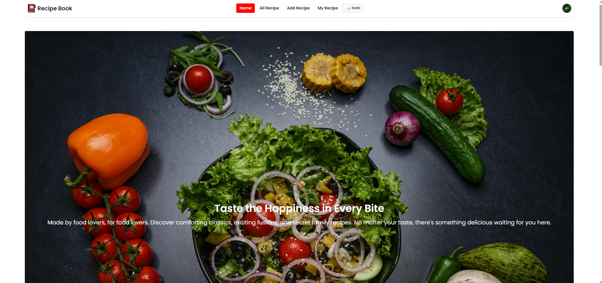
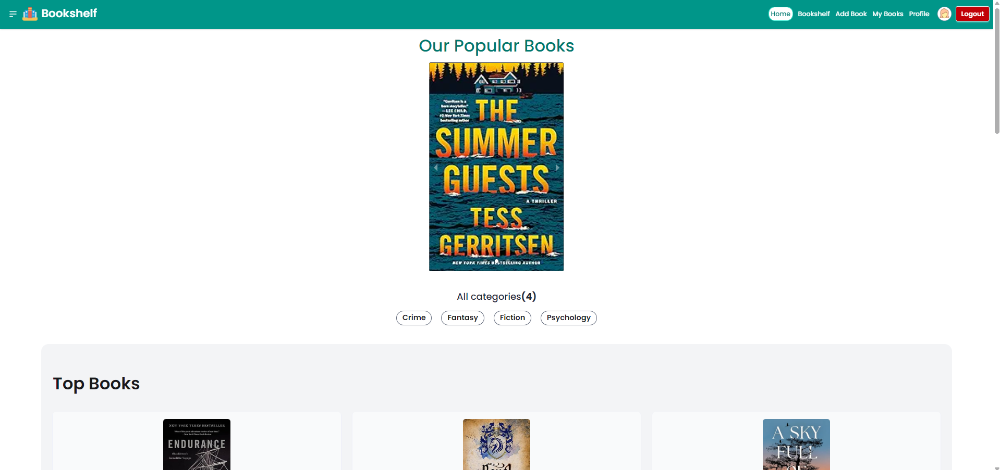
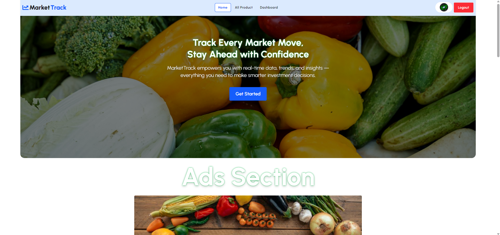

<!-- Banner Image -->

<!-- Name and Designation -->
<h1 align="center">Hi 👋, I'm Md Yasin Arafat</h1>
<h3 align="center">MERN Stack Developer</h3>

<!-- About Me -->
## 👨‍💻 About Me

- 🔭 I’m currently working on **a market tracking website**
- 🌱 I’m currently learning **Next.js**
- 🧠 I'm constantly improving my **React and TypeScript** skills
- 💬 Ask me about **JavaScript, React, Tailwind CSS**
- 📫 How to reach me: **your.email@example.com**

---

## 🚀 Current Activities

- 🔍 Exploring `Next.js` deeply — focusing on **App Router**, **server components**, and **middleware**
- 📘 Learning `TypeScript` to write more maintainable and scalable frontends
- 🍃 Diving into `Mongoose` for efficient MongoDB data modeling
- 📊 Developing a **Market Tracking Web App** to monitor trends and visualize analytics
- ⚛️ Practicing advanced `React` and `Next.js` patterns like **colocation**, **layout composition**, and **progressive rendering**

---

## 🛠️ Skills

### 💻 Frontend

  
  
  
  
  
  

### 🧠 Programming Languages & DSA

  
  
  
  

### 🌐 Backend & Database

  
  

### ⚙️ Tools & Others

  
  
  
  

---

## 🌐 Connect with me

  
  

---

## 📊 GitHub Stats

>
---

## 📉 Contribution Graph

---

## 📌 Pinned Projects

### 🧾 1. Recipe Book  
A user-friendly web application to store, manage, and search your favorite cooking recipes. Users can add, edit, and delete recipes with a clean UI.

**Features:**
- Add, view, update, and delete recipes
- Search functionality
- Responsive design

**Tech Stack:** React, React Router, Tailwind CSS, Firebase

🔗 [Live Site](https://recipe-book-app-e138e.web.app/)  
🔗 [GitHub Repo](https://github.com/arafat-yasin-2413/my-recipe-book-client)

---

### 📚 2. Bookshelf  
Bookshelf is a web app where users can manage a collection of books — add, update, read, and track reading progress.

**Features:**
- Add and update books
- Mark as read/watch
- Simple UI and smooth user experience

**Tech Stack:** React, Tailwind CSS, Firebase

🔗 [Live Site](https://bookshelf-project-d43ac.web.app/)  
🔗 [GitHub Repo](https://github.com/arafat-yasin-2413/my-bookshelf-client)

---

### 🛒 3. Market Track  
Market Track is a feature-rich app to monitor and analyze fresh vegetable prices. Users, vendors, and admins can track price trends, manage orders, payments, and more.

**Features:**
- Track current & previous prices
- Price trend analysis
- Watchlist, Orders, Role-based dashboard
- Payment integration

**Tech Stack:** React, React Query, Tailwind CSS, Node.js/Firebase

🔗 [Live Site](https://market-track-project.web.app/)  
🔗 [GitHub Repo](https://github.com/arafat-yasin-2413/my-market-track-client)

<!--
**arafat-yasin-2413/arafat-yasin-2413** is a ✨ _special_ ✨ repository because its `README.md` (this file) appears on your GitHub profile.

Here are some ideas to get you started:

- 🔭 I’m currently working on ...
- 🌱 I’m currently learning ...
- 👯 I’m looking to collaborate on ...
- 🤔 I’m looking for help with ...
- 💬 Ask me about ...
- 📫 How to reach me: ...
- 😄 Pronouns: ...
- ⚡ Fun fact: ...
-->
